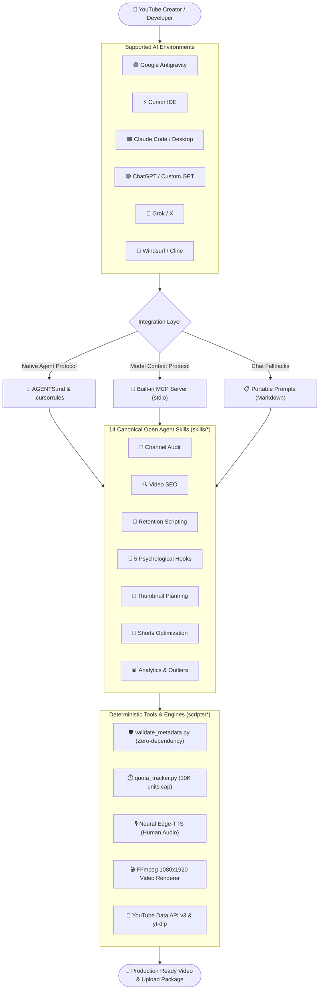
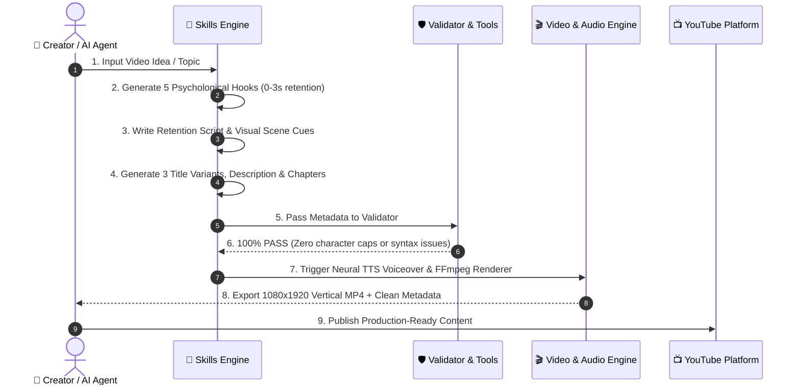

# 🚀 YouTube Agent Kit: Universal Multi-Agent AI Toolkit

[]()
[](LICENSE)
[](https://agentskills.io/)
[](https://modelcontextprotocol.io/)
[]()

> A universal, open-standard, multi-agent AI toolkit for YouTube creators and video automation. Designed to research, script, validate, optimize, and produce YouTube videos seamlessly across **Google Antigravity, Cursor IDE, Claude, ChatGPT, Grok, Gemini, Windsurf, Cline**, and developer APIs without vendor lock-in.

---

## 📑 Table of Contents

1. [System Architecture](#-system-architecture)
2. [End-to-End Creator Workflow Flowchart](#-end-to-end-creator-workflow)
3. [How to Access in Every AI Tool](#-how-to-access-in-every-ai-tool)
   - [Google Antigravity](#1-google-antigravity)
   - [Cursor IDE](#2-cursor-ide)
   - [ChatGPT (Web & Custom GPTs)](#3-chatgpt-web--custom-gpts)
   - [Claude (Code & Desktop)](#4-claude-claude-code--desktop)
   - [Grok (X / Web)](#5-grok-x--web)
   - [Windsurf / Cline / Roo Code](#6-windsurf--cline--roo-code)
   - [Python CLI / Global Package](#7-python-cli--global-package)
4. [The 14 Canonical Agent Skills](#-the-14-canonical-agent-skills)
5. [Autonomous Video Generation & Testing](#-autonomous-video-generation--testing)
6. [Local Deterministic Validation](#-local-deterministic-validation)
7. [Security & Quota Management](#-security--quota-management)
8. [License](#-license)

---

## 🏛️ System Architecture



---

## 🔄 End-to-End Creator Workflow



---

## 🔌 How to Access in Every AI Tool

### 1. 🟣 Google Antigravity

Antigravity natively discovers Agent Skills conforming to the open [Agent Skills specification](https://agentskills.io/).

* **Workspace Setup:** Open this repository folder in Antigravity. It automatically reads [`AGENTS.md`](AGENTS.md).
* **MCP Integration:** Add to your Antigravity MCP settings (`mcp_config.json`):
  ```json
  {
    "mcpServers": {
      "youtube-agent-kit": {
        "command": "python",
        "args": ["d:/youtube-skills-ai/mcp-server/server.py"],
        "env": {
          "YOUTUBE_API_KEY": "YOUR_API_KEY_HERE"
        }
      }
    }
  }
  ```
* **Prompt Example:**
  > *"Use the `hook-generation` skill to write 5 opening hooks for an AI automation tutorial."*

---

### 2. ⚡ Cursor IDE

Cursor uses `.cursorrules` and standard Model Context Protocol.

* **Configuration:** Preconfigured [`.cursorrules`](adapters/cursor/.cursorrules) is in the root directory.
* **Register MCP Server:**
  1. Go to **Cursor Settings ➔ Features ➔ MCP**.
  2. Click **Add New MCP Server**:
     - **Name:** `youtube-agent-kit`
     - **Command:** `python d:/youtube-skills-ai/mcp-server/server.py`
     - **Environment:** `YOUTUBE_API_KEY=YOUR_KEY_HERE`
* **Prompt Example in Composer (`Ctrl+I` / `Cmd+I`):**
  > *"@AGENTS.md Run video-seo for our upcoming video and validate character limits."*

---

### 3. 🤖 ChatGPT (Web & Custom GPTs)

Standard ChatGPT cannot run local code directly, but you can give it permanent access:

#### Method A: Create a Custom YouTube Creator GPT (Recommended ⭐)
1. Open [ChatGPT](https://chatgpt.com) ➔ **Explore GPTs** ➔ **Create**.
2. **Name:** `YouTube Agent Kit Copilot`
3. **Instructions:** Copy the entire text of [`AGENTS.md`](AGENTS.md) and paste it into the Instructions box.
4. **Knowledge Files:** Upload the markdown files from:
   - `skills/video-seo/SKILL.md`
   - `skills/hook-generation/SKILL.md`
   - `skills/shorts-optimization/SKILL.md`
   - `skills/script-writing/SKILL.md`
   - `references/algorithm-guide.md`
   - `references/retention-scripting-guide.md`
5. Save & Publish to yourself. You now have a private 24/7 YouTube consultant in ChatGPT!

#### Method B: Portable Prompts (Zero Setup)
Open [`portable-prompts/`](portable-prompts/) (e.g., [`video-seo.md`](portable-prompts/video-seo.md) or [`hook-generation.md`](portable-prompts/hook-generation.md)), copy the text, and paste it into any ChatGPT conversation.

---

### 4. 🟧 Claude (Claude Code & Desktop)

* **Claude Code (CLI):**
  Run the automated installer:
  ```powershell
  .\install.ps1
  ```
  Then invoke commands directly in your terminal:
  ```bash
  claude
  /youtube audit @channel
  /youtube seo "Building AI Agents"
  /youtube hook "Personal Finance in 2026"
  ```
* **Claude Desktop:**
  Add to your `claude_desktop_config.json`:
  ```json
  {
    "mcpServers": {
      "youtube-agent-kit": {
        "command": "python",
        "args": ["d:/youtube-skills-ai/mcp-server/server.py"],
        "env": {
          "YOUTUBE_API_KEY": "YOUR_API_KEY_HERE"
        }
      }
    }
  }
  ```

---

### 5. 🦅 Grok (X / Web)

Grok specializes in viral angles, social discourse, and trending patterns:
1. Copy the instructions from [`portable-prompts/hook-generation.md`](portable-prompts/hook-generation.md).
2. Paste into Grok with your topic:
   > *"Topic: 3 AI Tools that automate manual workflows. Generate 5 psychological hook scripts following the instructions above."*

---

### 6. 🌊 Windsurf / Cline / Roo Code

Add to your `cline_mcp_settings.json` or Windsurf MCP panel:
```json
{
  "mcpServers": {
    "youtube-agent-kit": {
      "command": "python",
      "args": ["d:/youtube-skills-ai/mcp-server/server.py"],
      "env": {
        "YOUTUBE_API_KEY": "YOUR_API_KEY_HERE"
      }
    }
  }
}
```

---

### 7. 📦 Python CLI & Global Package

Install the entire toolkit globally via Git:
```bash
pip install git+https://github.com/vbreddymora/youtube-agent-kit.git
```

Run automated Short video generation:
```bash
python scripts/generate_short_video.py
```

---

## 🎯 The 14 Canonical Agent Skills

Each skill is an open-standard module located in [`skills/`](skills/) containing strict procedural instructions, benchmark references, and output schemas:

| # | Skill Name | Path | What It Does | Prompt Example |
|:---:|:---|:---|:---|:---|
| **1** | **Channel Audit** | [`skills/channel-audit/`](skills/channel-audit/SKILL.md) | 4-track audit (SEO, velocity, content gaps, RPM) with 30-day sprint plan. | *"Audit channel @Veritasium using the channel-audit skill."* |
| **2** | **Video SEO** | [`skills/video-seo/`](skills/video-seo/SKILL.md) | 3 title variants, 5000-char description, tags < 500 chars, chapters, and JSON-LD schema. | *"Prepare complete SEO metadata for 'How to Build AI Agents'."* |
| **3** | **Script Writing** | [`skills/script-writing/`](skills/script-writing/SKILL.md) | Retention-engineered long-form script with 30s hook triad and 60s pattern interrupts. | *"Write an 8-minute educational script on Quantum Computing."* |
| **4** | **Hook Generation** | [`skills/hook-generation/`](skills/hook-generation/SKILL.md) | 5 psychological 30s hook variants (Shock, Agitation, Story, Curiosity, Proof). | *"Generate 5 viral hooks for a video about side hustles."* |
| **5** | **Thumbnail Planning**| [`skills/thumbnail-planning/`](skills/thumbnail-planning/SKILL.md)| Visual hierarchy, color hex palette, title-thumbnail synergy, and 3 A/B test briefs. | *"Plan 3 high-CTR thumbnail concepts for a Coding Tutorial."* |
| **6** | **Shorts Optimization**| [`skills/shorts-optimization/`](skills/shorts-optimization/SKILL.md)| 9:16 vertical video script with visual cuts every 3s, Viewed vs Swiped Away focus. | *"Script a 50s viral Short on 3 AI automation tools."* |
| **7** | **Competitor Analysis**| [`skills/competitor-analysis/`](skills/competitor-analysis/SKILL.md)| Discovers 3x+ view outlier videos, keyword vacancies, and audience sentiment. | *"Analyze top competitors in the personal finance niche."* |
| **8** | **Video Ideation** | [`skills/video-ideation/`](skills/video-ideation/SKILL.md) | 10 ranked video ideas with search vs browse traffic strategies and thumbnail angles. | *"Give me 10 high-retention video ideas for a tech channel."* |
| **9** | **Content Strategy** | [`skills/content-strategy/`](skills/content-strategy/SKILL.md) | Hub/Hero/Help content pillars, channel positioning statement, 90-day roadmap. | *"Build a 90-day growth strategy for a new B2B SaaS channel."* |
| **10**| **Content Calendar** | [`skills/content-calendar/`](skills/content-calendar/SKILL.md) | Monthly calendar with optimal publish windows and seasonal CPM timings. | *"Create a 4-week publishing calendar for November."* |
| **11**| **Analytics Analysis**| [`skills/analytics-analysis/`](skills/analytics-analysis/SKILL.md)| Funnel diagnosis (Impressions ➔ CTR ➔ AVD), retention drop-off fixes. | *"Diagnose my retention curve where 40% drops at 0:30."* |
| **12**| **Content Repurposing**| [`skills/content-repurposing/`](skills/content-repurposing/SKILL.md)| Converts 1 long-form video into 5 Shorts, LinkedIn post, X thread, and newsletter. | *"Repurpose this video transcript into 3 Shorts and an X thread."* |
| **13**| **Monetization** | [`skills/monetization/`](skills/monetization/SKILL.md) | 7-stream revenue gap analysis, sponsorship rate card, affiliate matrix. | *"Calculate sponsorship rates for a channel with 50K avg views."* |
| **14**| **Upload Metadata** | [`skills/upload-metadata/`](skills/upload-metadata/SKILL.md) | Copy-paste-ready Studio packaging: final title, description, tags, and settings. | *"Assemble upload package for video #102."* |

---

## 🎬 Autonomous Video Generation & Testing

This toolkit features built-in headless generation of real, high-retention vertical **1080x1920 MP4 video files**:

```bash
# 1. Generate full Short with Neural TTS & Multi-scene FFmpeg rendering
python scripts/generate_short_video.py
```

### What this produces:
1. **Studio Neural Voiceover (`voiceover_neural.mp3`):** Synthesized using Microsoft `edge-tts` (Christopher Neural) with zero robotic artifacts.
2. **Burned Hormozi-Style Subtitles:** High-contrast, bold yellow captions with dark borders burned directly onto the video frames.
3. **Multi-Scene Pacing:** Changes scene every 3 to 10 seconds to maintain high viewer retention.
4. **Output Video:** Standard 1080x1920 H.264 MP4 saved directly at [`output_short.mp4`](output_short.mp4).

### Interactive 9:16 Simulator
Preview pacing and captions in your browser before uploading:
```powershell
Start-Process "preview_short.html"
```

---

## 🛡️ Local Deterministic Validation

Never get penalized by YouTube algorithm caps or mobile truncation. Validate any metadata instantly without an API key:

```bash
python scripts/validate_metadata.py \
  --title "How to Build an AI Agent in 2026 (Step-by-Step)" \
  --description "Full complete tutorial for developers. #AIAgents #Python #Tutorial" \
  --tags "ai agents, python ai, autonomous agents, tutorial 2026" \
  --chapters "0:00 - Intro\n1:30 - Setup\n5:00 - Code\n12:00 - Testing"
```

### Checks Performed:
- **Title Length:** 50-70 characters (optimal for mobile without truncation; flags > 100 chars).
- **Description:** First 150 chars above-the-fold summary verification; caps at 5,000 chars.
- **Tags:** Total character length under the 500-character YouTube limit.
- **Hashtags:** Validates 3-5 recommended tags (flags spam if > 15 hashtags).
- **Chapters:** Verifies mandatory `00:00` start, minimum of 3 chapters, and clean formatting.

---

## 🔒 Security & Quota Management

- **Zero Hardcoded Secrets:** Credentials and tokens are read strictly from environment variables (`YOUTUBE_API_KEY`) and are ignored in `.gitignore`.
- **API Quota Protection:** Tracks daily YouTube Data API v3 unit usage against the 10,000-unit quota limit.
  ```bash
  python scripts/utils/quota_tracker.py --check
  ```
- **Read-Only Scopes:** Default API integrations query public data or read-only Analytics scopes.

---

## 🧪 Testing

The repository includes a comprehensive unit test suite covering path resolution, quota tracking, and deterministic metadata validation:

```bash
python -m unittest discover tests
```
*(Result: 13 tests pass in < 0.05s)*

---

## 📄 License

Distributed under the **MIT License**. Free for individual creators, media agencies, and software developers.
