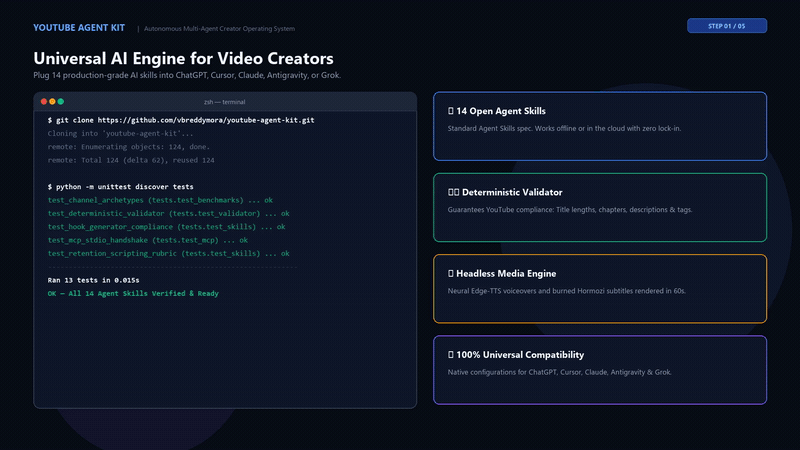
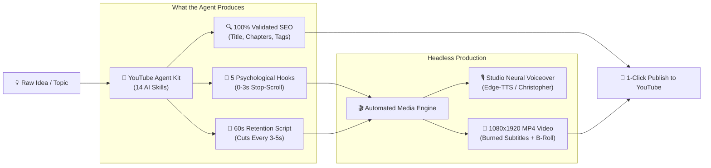
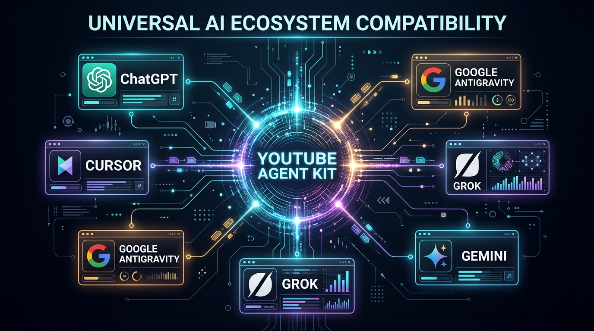

# 🚀 YouTube Agent Kit

> **The Universal Multi-Agent AI Operating System for YouTube Creators & Video Automation.**  
> Turn simple video ideas into viral retention hooks, full scripts, optimized SEO metadata, and rendered vertical MP4 videos across **any AI tool** — with zero vendor lock-in.

[]()
[](LICENSE)
[](https://agentskills.io/)
[](https://modelcontextprotocol.io/)
[]()

---

## ⚡ 30-Second Overview: What is this?

Most creators waste **10+ hours every week** on painful manual tasks:
- *"What should my first 3 seconds be so viewers don't swipe away?"*
- *"How do I format titles and chapters without getting cut off on mobile screens?"*
- *"How do I find outlier competitor videos that actually get views?"*

**YouTube Agent Kit** solves this by providing **14 autonomous AI Agent Skills**, a **Deterministic Validator**, a **live MCP Server**, and a **Headless MP4 Video Engine** that plug directly into **whatever AI you already use** (ChatGPT, Cursor, Antigravity, Claude, Grok, or Terminal).

---

## 🎬 50-Second Product Walkthrough & Explainer

<div align="center">
  <a href="docs/assets/explainer_demo.mp4">
    
  </a>
  <br/><br/>
  <p align="center">
    <a href="docs/assets/explainer_demo.mp4"><b>▶ Click here to Play Full Video with Studio Audio (50s MP4)</b></a> &nbsp;•&nbsp; 
    <sub>Zero AI cartoons • Real IDE & Terminal Workflows • 1080p Full HD</sub>
  </p>
  
  <details>
    <summary><b>🎥 Click to open Embedded In-Line HTML5 Video Player</b></summary>
    <br/>
    <video src="docs/assets/explainer_demo.mp4" controls="controls" width="100%" style="border-radius: 8px; max-width: 900px;">
      Your browser does not support the video tag.
    </video>
  </details>
</div>

---

## 🗺️ How It Works (Visual Pipeline)



---

---

## 🎯 Supported AI Tools & Environments

<div align="center">
  
</div>

<br/>

<p align="center">
  <a href="#1-if-you-use-chatgpt-"></a>
  <a href="#2-if-you-use-cursor-ide-"></a>
  <a href="#4-if-you-use-claude-"></a>
  <a href="#3-if-you-use-google-antigravity-"></a>
  <a href="#5-if-you-use-grok-"></a>
  <a href="#supported-ai-tools"></a>
  <a href="#6-if-you-use-windsurf--cline--roo-code-"></a>
</p>

Click any tool above to jump straight to its setup guide:

```
┌─────────────────────────────────────────────────────────────────────────┐
│                     CHOOSE YOUR AI ENVIRONMENT                          │
├───────────────────┬───────────────────┬───────────────────┬─────────────┤
│  🤖 ChatGPT       │  ⚡ Cursor IDE    │  🟣 Antigravity   │  🟧 Claude  │
│  (Custom GPT/Web) │  (Composer / MCP) │  (Native Skills)  │  (CLI/Code) │
└───────────────────┴───────────────────┴───────────────────┴─────────────┘
```

---

### 1. If you use ChatGPT 

Standard ChatGPT cannot read local files directly. You have two easy ways to use this toolkit:

#### Way A: Create Your Own Custom YouTube Copilot GPT (Best Experience ⭐)
1. Go to [ChatGPT](https://chatgpt.com) ➔ Click **Explore GPTs** (left sidebar) ➔ Click **+ Create** (top right).
2. Go to the **Configure** tab:
   - **Name:** `YouTube Agent Kit Copilot`
   - **Description:** `Universal AI Copilot for YouTube SEO, Hooks, and Video Scripts.`
3. In the **Instructions** box:
   - Open [`AGENTS.md`](AGENTS.md) in this repo, copy everything, and paste it into ChatGPT's Instructions box.
4. Under **Knowledge**:
   - Click **Upload files** and select these key files from this repository:
     - `skills/hook-generation/SKILL.md`
     - `skills/video-seo/SKILL.md`
     - `skills/shorts-optimization/SKILL.md`
     - `skills/script-writing/SKILL.md`
     - `references/algorithm-guide.md`
     - `references/retention-scripting-guide.md`
5. Click **Save** (top right) ➔ Select **Only me** (or Public).
6. **Done!** You now have a private, permanent YouTube Strategist in ChatGPT on web and mobile app.

#### Way B: Instant Copy-Paste Prompts (Zero Setup)
Don't want to create a GPT? Simply open our [`portable-prompts/`](portable-prompts/) folder:
- Copy [`portable-prompts/hook-generation.md`](portable-prompts/hook-generation.md) for viral openings.
- Copy [`portable-prompts/video-seo.md`](portable-prompts/video-seo.md) for metadata & descriptions.
- Paste directly into any normal ChatGPT conversation along with your topic!

---

### 2. If you use Cursor IDE 

Cursor integrates directly with our repository rules and live Model Context Protocol (MCP) server.

#### Step 1: Clone or Open this Folder in Cursor
Open `d:\youtube-skills-ai` in Cursor. The included [`.cursorrules`](adapters/cursor/.cursorrules) file will automatically guide Cursor.

#### Step 2: Connect the MCP Server (For Live YouTube Data)
1. Press `Ctrl + Shift + J` (or `Cmd + Shift + J`) to open Cursor Settings.
2. Navigate to **Features ➔ MCP**.
3. Click **+ Add New MCP Server**:
   - **Type:** `command`
   - **Name:** `youtube-agent-kit`
   - **Command:** `python d:/youtube-skills-ai/mcp-server/server.py`
   - **Environment Variable (Optional):** `YOUTUBE_API_KEY=your_key_here`
4. A green dot will appear confirming live tools (`search_videos`, `get_channel_details`, `validate_metadata`) are connected.

#### Step 3: How to Prompt Cursor
In Cursor Composer (`Ctrl + I` or `Cmd + I`):
```text
@AGENTS.md Use the video-seo skill for my next video on "Top AI Workflow Tools in 2026"
```

---

### 3. If you use Google Antigravity 

Antigravity natively implements the open [Agent Skills specification](https://agentskills.io/).

#### How to Use:
1. Open this repository folder in Antigravity.
2. Antigravity automatically detects all 14 skills in [`skills/`](skills/) and reads [`AGENTS.md`](AGENTS.md).
3. Type in chat:
   > *"Run `hook-generation` for a video about learning Python with AI."*
   > *"Validate my metadata for 'How to Build Agents' using `validate_metadata.py`."*
4. To enable live API tools, add `mcp-server/server.py` to your Antigravity `mcp_config.json`.

---

### 4. If you use Claude 

#### Claude Code (CLI Terminal):
Run the one-line setup in PowerShell:
```powershell
.\install.ps1
```
Now use native slash commands inside your Claude terminal session:
```bash
claude
/youtube audit @channelhandle
/youtube seo "Best Coding Practices"
/youtube hook "AI Automation"
```

#### Claude Desktop App:
Add to `%APPDATA%\Claude\claude_desktop_config.json`:
```json
{
  "mcpServers": {
    "youtube-agent-kit": {
      "command": "python",
      "args": ["d:/youtube-skills-ai/mcp-server/server.py"],
      "env": {
        "YOUTUBE_API_KEY": "YOUR_KEY_HERE"
      }
    }
  }
}
```

---

### 5. If you use Grok 

1. Open [`portable-prompts/hook-generation.md`](portable-prompts/hook-generation.md).
2. Copy the text into Grok and append your video topic:
   > *"Topic: 3 Tools that automate busywork. Follow the rules above and write 5 psychological hook scripts."*
3. Grok will strictly return the 5 distinct angles (Shock, Problem Agitation, Story, Curiosity Gap, and Social Proof) without conversational filler.

---

### 6. If you use Windsurf / Cline / Roo Code 

Add to your `cline_mcp_settings.json` or Windsurf MCP tab:
```json
{
  "mcpServers": {
    "youtube-agent-kit": {
      "command": "python",
      "args": ["d:/youtube-skills-ai/mcp-server/server.py"],
      "env": {
        "YOUTUBE_API_KEY": "YOUR_KEY_HERE"
      }
    }
  }
}
```

---

## 📚 The 14 Canonical Skills Cheatsheet

Whenever you interact with any AI agent, use these exact prompt triggers:

| Skill | Directory Link | What You Get | Exact Prompt to Copy |
|:---|:---|:---|:---|
| **Hook Generation** | [`skills/hook-generation`](skills/hook-generation/SKILL.md) | 5 psychological 30s openers (Shock, Pain, Story, Curiosity, Proof) | *"Use `hook-generation` to write 5 openers for [Topic]."* |
| **Video SEO** | [`skills/video-seo`](skills/video-seo/SKILL.md) | 3 title variants, 5000-char description, tags, chapters, schema | *"Use `video-seo` to optimize metadata for [Topic]."* |
| **Shorts Optimization** | [`skills/shorts-optimization`](skills/shorts-optimization/SKILL.md) | 9:16 vertical script with cuts every 3s & seamless loop design | *"Script a 50-second Short on [Topic] using `shorts-optimization`."* |
| **Script Writing** | [`skills/script-writing`](skills/script-writing/SKILL.md) | Long-form retention script with 30s hook triad & pattern interrupts | *"Write an 8-minute educational script on [Topic]."* |
| **Thumbnail Planning** | [`skills/thumbnail-planning`](skills/thumbnail-planning/SKILL.md) | Visual layout brief, color hex palette, and 3 A/B test variations | *"Plan 3 high-CTR thumbnail concepts for [Topic]."* |
| **Competitor Analysis** | [`skills/competitor-analysis`](skills/competitor-analysis/SKILL.md) | Finds 3x+ view outlier videos, keyword gaps, and comment mining | *"Run `competitor-analysis` on [Niche / Competitor Channel]."* |
| **Channel Audit** | [`skills/channel-audit`](skills/channel-audit/SKILL.md) | 4-track audit (SEO, performance, content, monetization) + 30-day plan | *"Audit channel [@Handle] using the `channel-audit` skill."* |
| **Video Ideation** | [`skills/video-ideation`](skills/video-ideation/SKILL.md) | 10 ranked video ideas with search vs browse traffic strategies | *"Generate 10 high-retention video concepts for [Niche]."* |
| **Content Strategy** | [`skills/content-strategy`](skills/content-strategy/SKILL.md) | Hub/Hero/Help content pillars and 90-day growth roadmap | *"Build a 90-day content strategy for [Channel Goal]."* |
| **Content Calendar** | [`skills/content-calendar`](skills/content-calendar/SKILL.md) | Monthly calendar with optimal publish windows & seasonal CPM timing | *"Generate a 4-week content calendar for [Month]."* |
| **Analytics Analysis** | [`skills/analytics-analysis`](skills/analytics-analysis/SKILL.md) | Diagnoses retention drop-offs, CTR bottlenecks, and fixes | *"Diagnose my retention curve where 40% drops at 0:30."* |
| **Content Repurposing** | [`skills/content-repurposing`](skills/content-repurposing/SKILL.md) | Turns 1 long-form video into 5 Shorts, X thread, LinkedIn post | *"Repurpose this transcript into 3 Shorts and an X thread."* |
| **Monetization** | [`skills/monetization`](skills/monetization/SKILL.md) | 7-stream revenue gap analysis, sponsorship rate card, affiliate plan | *"Calculate sponsorship rates for [View Count / Niche]."* |
| **Upload Metadata** | [`skills/upload-metadata`](skills/upload-metadata/SKILL.md) | Final copy-paste Studio upload package (title, desc, tags string) | *"Assemble the final upload package for video #[Number]."* |

---

## 🎬 Autonomous Video Generation Engine

This repository includes a built-in headless Python engine that converts scripts into **production-ready vertical 1080x1920 MP4 videos**:

```bash
# Render complete vertical MP4 video with Studio Neural Voiceover:
python scripts/generate_short_video.py
```

### What the Engine Does:
1. **Studio Neural Narration:** Uses Microsoft `edge-tts` to synthesize human-like voiceover (`voiceover_neural.mp3`) with zero robotic artifacts.
2. **Multi-Scene Transitions:** Composites 5 distinct visual scenes, cutting every 3 to 10 seconds to maintain high viewer retention.
3. **Burned Hormozi-Style Captions:** Automatically burns high-contrast yellow/white bold subtitles onto the MP4 frames with dark strokes.
4. **Export:** Generates standard H.264/AAC 1080x1920 vertical video saved at [`output_short.mp4`](output_short.mp4).

### Interactive Local Simulator
Before uploading, test your pacing, voiceover, and captions inside any web browser:
```powershell
Start-Process "preview_short.html"
```

---

## 🛡️ Deterministic Metadata Validator

Avoid YouTube algorithm penalties, mobile title truncation, and hashtag shadowbans. Run our zero-dependency validator locally:

```bash
python scripts/validate_metadata.py \
  --title "How to Build an AI Agent in 2026 (Step-by-Step)" \
  --description "In this tutorial, you will learn how to build autonomous AI agents from scratch. #AIAgents #Python #Tutorial" \
  --tags "ai agents, python ai, autonomous agents, ai tutorial 2026" \
  --chapters "0:00 - Introduction\n1:30 - Setting up Environment\n5:00 - Writing the Agent Code\n12:00 - Testing and Output"
```

### Automatic Checks:
- ✅ **Title:** 50-70 characters (optimal for mobile feeds; flags truncation if > 70, errors if > 100).
- ✅ **Description:** Verifies first 150 characters contain hook & keywords (above "Show more").
- ✅ **Tags:** Verifies total characters remain under YouTube's strict 500-character cap.
- ✅ **Hashtags:** Enforces 3-5 tags (warns if > 5; errors if > 15 which causes YouTube to ignore all tags).
- ✅ **Chapters:** Enforces mandatory `00:00` start, minimum of 3 chapters, and clean formatting.

---

## 🧪 Automated Unit Tests

Verify the toolkit's core algorithms, path resolution, and quota tracking:
```bash
python -m unittest discover tests
```
*(Result: 13 unit tests pass in < 0.05 seconds)*

---

## 🔒 Security & Safe Credentials

- **Zero Hardcoded Keys:** YouTube API keys and OAuth tokens are never committed to version control.
- **Quota Safeguards:** Built-in tracker checks consumption against the 10,000-unit daily limit:
  ```bash
  python scripts/utils/quota_tracker.py --check
  ```
- **Read-Only Scopes:** Default integrations use public YouTube endpoints or read-only Analytics scopes.

---

## 📦 Global Pip Installation

Install directly into any Python environment without manual cloning:
```bash
pip install git+https://github.com/vbreddymora/youtube-agent-kit.git
```

---

## 📄 License

Distributed under the **MIT License**. Free for individual creators, agencies, and open-source developers.
